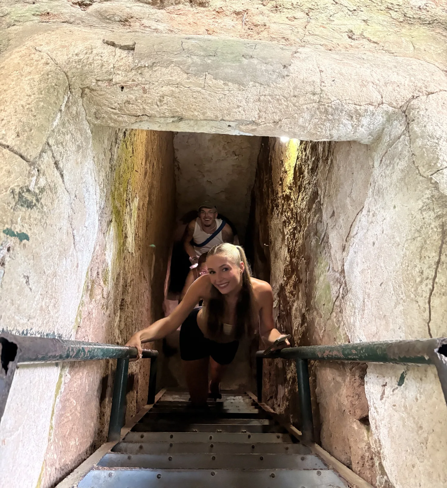

<strong>If you plan to visit both in one day, Cu Chi Tunnels first and the War Remnants Museum afterwards is usually the more practical order.</strong> The longer journey is easier to handle earlier, with the museum back in central Saigon in the afternoon. <strong>If you can visit only one</strong>, choose the museum for a shorter city-based visit and Cu Chi for an outdoor historical experience that requires more travel.

Neither place gives the whole story on its own. They are different ways of engaging with the history of war in Vietnam. The right choice depends on your time, physical comfort and interest in the subject.

<h2>What is the difference?</h2>

<table class="story-table"><thead><tr><th>Consideration</th><th>Cu Chi Tunnels</th><th>War Remnants Museum</th></tr></thead><tbody>
<tr><th>Setting</th><td>Outdoor historical landscape and tunnel infrastructure</td><td>Galleries, photographs, documents and equipment in central Saigon</td></tr>
<tr><th>What you learn</th><td>How a network of entrances, shelters and work areas functioned in its physical setting</td><td>The war's human consequences through objects, testimony and the museum's exhibitions</td></tr>
<tr><th>Effort</th><td>Longer road journey, heat and walking; crawling optional</td><td>Less travel, but considerable standing and reading</td></tr>
<tr><th>Best when</th><td>You want place-based history and have most of a day</td><td>You have a few hours or prefer an indoor visit</td></tr>
</tbody></table>

<h2>Why visit Cu Chi first when combining both?</h2>

Travelling out of the city in the morning puts the most time-sensitive road journey at the start of the day. You can experience the setting at Cu Chi, pause for lunch, and return to the museum for photographs and personal accounts that give another perspective on what you have seen.

This sequence is a logistical preference, not a rule about how history must be understood. A visitor who prefers documentary context before visiting a field site may deliberately choose the museum first, especially if they are splitting the visits across two days.

For new OG Saigon bookings the usual Cu Chi site is <strong>Ben Duoc Tunnels</strong>, generally less touristy than Ben Dinh Tunnels. The crawl is optional. Our current route includes a lacquer craft workshop with artisans with disabilities, while Ben Duoc Memorial Temple is not a mandatory stop. The actual sequence may change. Existing confirmed tours retain their agreed arrangements.

<figure><figcaption>At Cu Chi, the landscape and infrastructure are part of the historical evidence.</figcaption></figure>

<h2>What time does the War Remnants Museum close?</h2>

According to the museum's <a class="text-link" href="https://ticket.baotangchungtichchientranh.vn/terms-and-conditions-en.html" target="_blank" rel="noopener noreferrer">official visitor and ticketing terms</a>, it is open <strong>7:30 am to 5:30 pm daily</strong>, while ticket sales and new admissions close at <strong>5:00 pm</strong>. These are the published hours checked on 20 November 2026; reconfirm for your visit.

Do not plan to arrive at 4:45 pm and call it a proper museum visit. Allow time to enter, read and take breaks. A late arrival may technically be admitted but leaves little room to absorb the exhibits. We normally aim for an afternoon arrival comfortably before the last-admission time.

<h2>What could a realistic combined day look like?</h2>

For a full history day, an <strong>illustrative</strong> flow is:

<ul class="bullets">
<li><strong>Early morning:</strong> pickup in central Saigon and travel towards Ben Duoc, with the scheduled craft stop where it fits.</li>
<li><strong>Mid-morning:</strong> explore the Cu Chi Tunnels site at a measured pace. Entering a tunnel is a choice, never a requirement.</li>
<li><strong>Late morning or lunchtime:</strong> a food break and the journey back to the city.</li>
<li><strong>Early to mid-afternoon:</strong> visit the War Remnants Museum with enough time for its major galleries, not just the courtyard.</li>
<li><strong>Late afternoon:</strong> finish in the centre or return to your agreed drop-off point.</li>
</ul>

OG Saigon's combined private experience is usually estimated at <strong>8 to 8.5 hours</strong>. That is a planning estimate rather than a fixed clock schedule. Heavy traffic, longer discussions, meal breaks or the needs of your group may extend the day. If the return journey runs late, do not rush the museum or assume last admission will be extended.

<h2>Should you split the visits across two days?</h2>

Often, yes. Cu Chi requires outdoor walking and road travel; the museum can be emotionally intense. Its displays include images of suffering, injury and the effects of chemical warfare. Some guests prefer to leave the museum for a separate morning when they have energy and time to process what they see.

The museum has its own curatorial perspective. Photographs, artifacts and documentary records are not the same thing as every interpretation made about them. Reading captions carefully, asking about sources and hearing different historical experiences can make the visit more thoughtful, not less respectful.

<h2>What if you only have half a day or one day?</h2>

<strong>Half a day:</strong> the War Remnants Museum is usually the practical choice if you are staying in the centre. Cu Chi requires substantial travel and should not be squeezed into a short city window.

<strong>One day, with war history as your priority:</strong> both can work with an early start, a private vehicle and restrained expectations for additional sightseeing. <strong>One day, with broader Saigon interests:</strong> choose one history visit and leave time for neighbourhoods, food or rest. If the choice is Cu Chi alone, read <a class="text-link" href="/stories/cu-chi-without-crawling/">whether it is still worthwhile without crawling</a>.

Our preference is to give each site enough attention, even if that means doing less.

Continue planning
<h2>Experience the history</h2>

<a class="text-link" href="/experiences/cu-chi-war-museum/">Explore the private Cu Chi + War Remnants Museum day →</a>
<a class="text-link" href="/experiences/cu-chi-tunnels/">Prefer Cu Chi Tunnels on their own? →</a>

