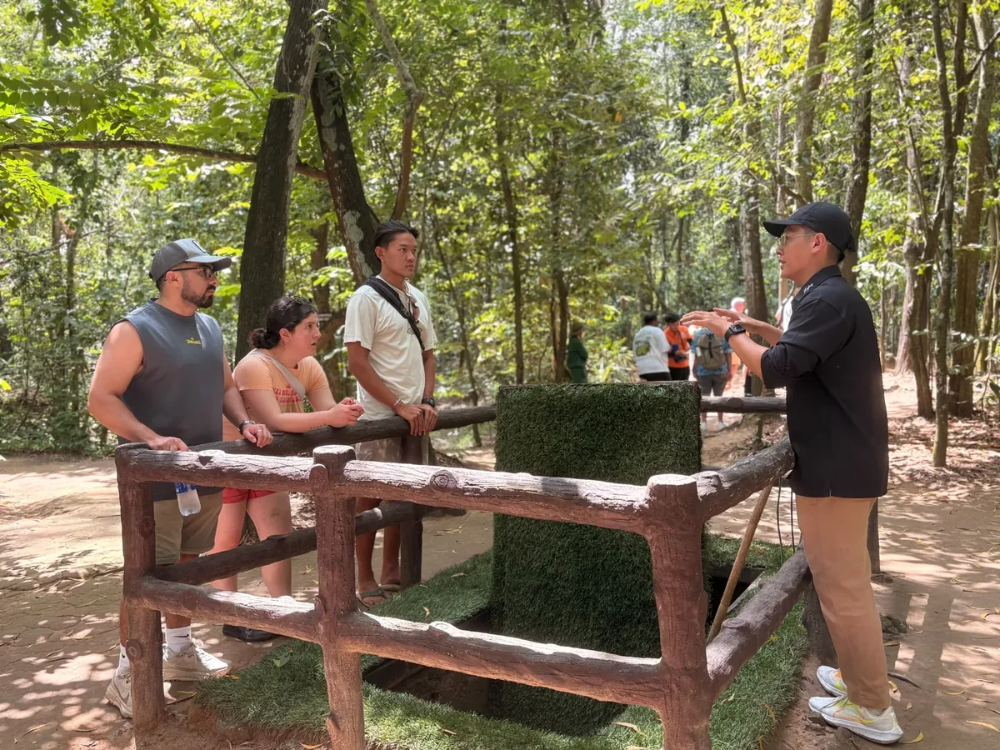

<strong>Yes, Cu Chi Tunnels can be worth visiting without crawling underground.</strong> The main experience is understanding how a wartime tunnel network worked within the landscape, not proving that you can fit into a narrow passage. But skipping the crawl does not make the entire site step-free or suitable for every mobility need.

If enclosed spaces make you uneasy, you have bad knees, or you simply do not want to crawl, you can still visit the surface exhibits and discuss how people used concealed entrances, shelters and connected working areas. The decision is less about courage and more about what you want to learn and how comfortable you will be outdoors.

<h2>What can you actually see above ground?</h2>

At the Cu Chi historical sites, the story begins in the trees and soil. Your guide can point out concealed entrances, explain how ventilation was disguised, and use reconstructed bunkers and working spaces to show how cooking, communication, shelter and movement connected to the tunnels. Exhibits and demonstrations vary by site and by the route operating on the day.

These are not just photo stops. A small entrance hidden beneath a lid makes more sense once you discuss how people concealed movement and supplies, and why the surrounding terrain mattered. You do not need to enter the tunnel to ask those questions.

<figure><figcaption>The questions you ask above ground can be more important than how far you crawl.</figcaption></figure>

<h2>What changes at Ben Duoc Tunnels?</h2>

For <strong>new private bookings</strong>, OG Saigon normally visits <strong>Ben Duoc Tunnels</strong> rather than Ben Dinh Tunnels. Ben Duoc generally feels less crowded, although the atmosphere depends on the day. It offers a broader historical setting for a conversation about the Cu Chi network, including surface exhibits and wartime infrastructure.

On our current Cu Chi route, there is also a stop at a lacquer craft workshop where artisans with disabilities work. At the site, a cassava and tea break offers time to discuss wartime food and daily life. A visit to <strong>Ben Duoc Memorial Temple is possible, not mandatory</strong>; timing and conditions determine whether it fits. The sequence may change, and previous confirmed bookings keep their agreed arrangements.

We do not use tunnel dimensions from Ben Dinh to describe Ben Duoc. Sections differ, and the available crawl should be assessed on site.

<h2>How difficult is the visit if you stay above ground?</h2>

Expect a drive out from central Saigon followed by outdoor walking, humidity, patches of uneven ground and places where you may stand while listening. Skipping the underground section removes the crawl itself, not the walking or the heat.

<strong>Not crawling is not the same as wheelchair accessibility.</strong> Paths, thresholds, steps, toilets and available assistance should be confirmed for the specific site and date. A private guide can adjust the pace, but cannot promise that every part of the grounds is accessible. If a guest uses a wheelchair or mobility aid, ask for a route-specific assessment before booking rather than relying on a general claim that Cu Chi is accessible.

Older travellers are not one group. Someone who walks comfortably outdoors may find the visit manageable; someone with balance issues or fatigue may not. A slow pace, seated breaks when available, water and supportive footwear help, but they do not remove every physical barrier.

<h2>Who should skip the crawl?</h2>

Anyone uncomfortable with confined, dark or warm spaces can decline it. People with knee, hip or back problems, breathing or heart concerns, recent surgery, or difficulty crouching should be particularly cautious and seek appropriate personal medical advice where needed. Children and adults alike should choose freely. There is no requirement to try a tunnel section to have a complete discussion of the site.

If you do decide to enter, listen to the on-site instructions and turn back whenever you feel uncomfortable. Do not assume all passages are the same or that a guide can remove the physical demands.

<h2>When might Cu Chi not be worth the trip?</h2>

Cu Chi is a substantial excursion from the centre, not a quick city museum visit. If you have only one relaxed half-day in Saigon, cannot tolerate much outdoor walking or heat, or would rather spend your time with photographs and documents, the <a class="text-link" href="/stories/cu-chi-or-war-remnants-museum/">War Remnants Museum may be the better choice</a>. The same goes for someone with little interest in wartime history. There is no reason to force it into every itinerary.

OG Saigon's current Cu Chi-only private experience is planned at roughly <strong>6.5 to 7 hours</strong> including the journey from and back to central Saigon. Traffic and actual stops can change the timing. For many guests, the travel commitment matters more than the optional ten minutes they might spend underground.

<h2>What does a good local guide add?</h2>

A guide can connect individual entrances and displays into a clearer account of daily life, military logistics and the decisions people made under difficult circumstances. Just as importantly, a guide should welcome questions, separate what is visible from interpretation, and tell you when something is uncertain. You should not need to crawl to receive that context.

If the history interests you and the outdoor visit suits your group, Cu Chi can be worthwhile without the crawl. If accessibility or comfort is the deciding factor, discuss the practical requirements first.

Plan the visit
<h2>Explore the options</h2>

<a class="text-link" href="/experiences/cu-chi-tunnels/">See our private Cu Chi Tunnels experience →</a>
<a class="text-link" href="/stories/cu-chi-or-war-remnants-museum/">Cu Chi or the War Remnants Museum first? →</a>

