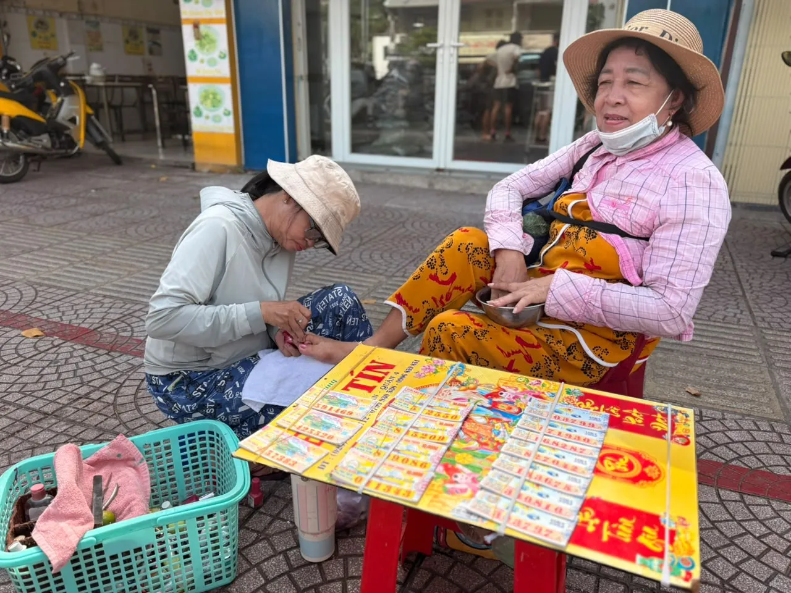
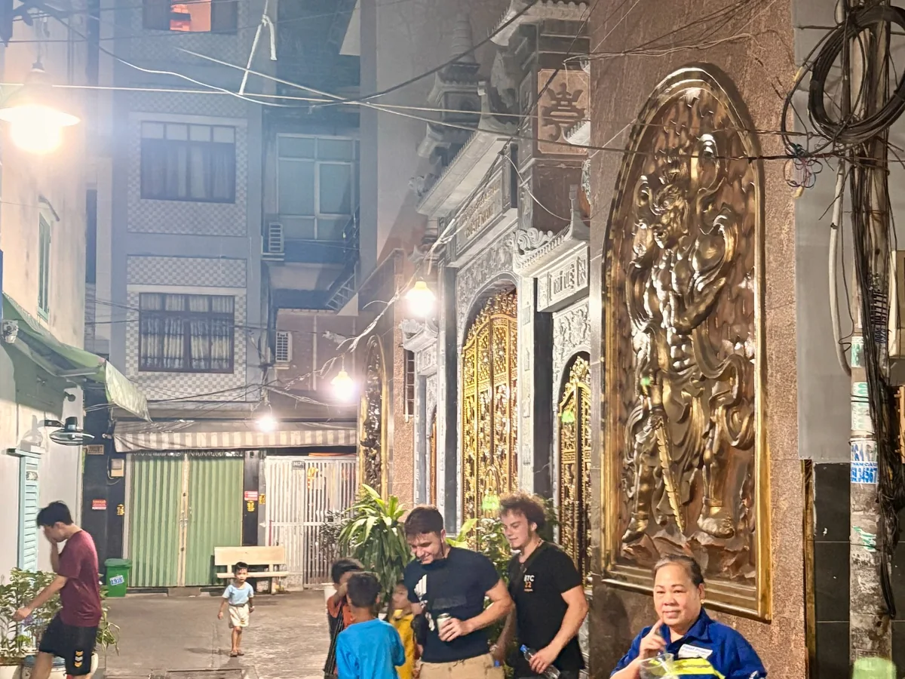
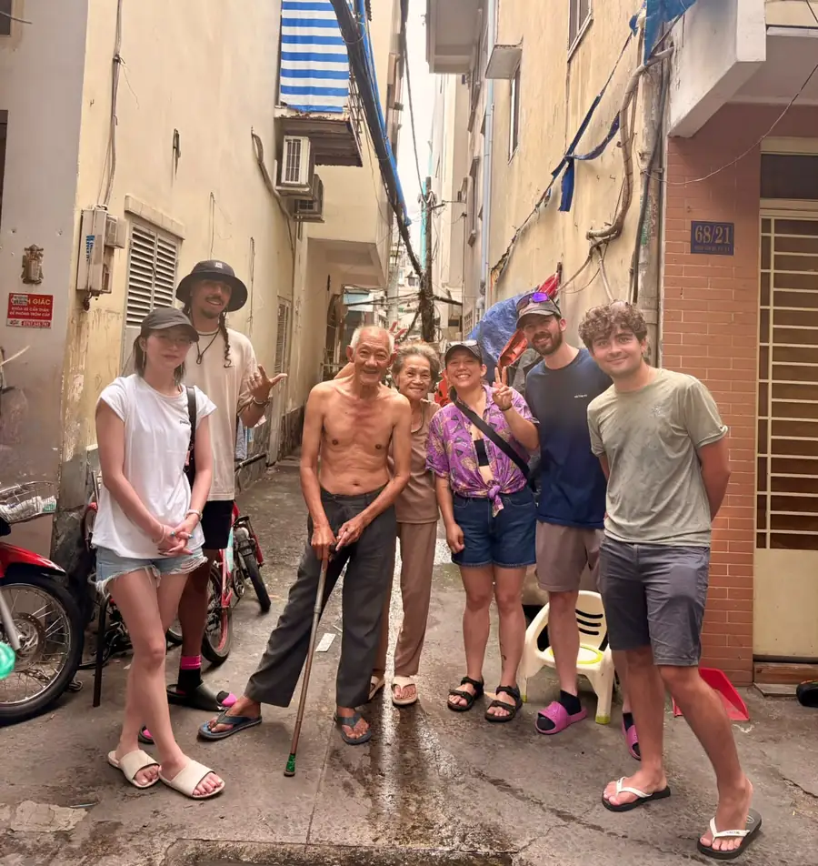

  
<strong>District 4 at a glance:</strong> District 4, known locally as Quận Tư, is a historic riverside area of Saigon, or Ho Chi Minh City. Bordered by the Saigon River, Bến Nghé Creek and Tẻ Canal, it grew around waterways, the port, working families, markets and residential alleys. Today it is known for Xóm Chiếu, seafood culture and a changing waterfront. To explore Saigon with a local is to look beyond landmarks and understand places like this in their everyday context.

There is a short distance between central Saigon and old District 4. Cross a bridge over Bến Nghé Creek and you are already there.

But a short distance on a map does not always tell you much about a place.

On one side, Saigon's commercial center. On the other, a neighborhood shaped by water, the port, the work that came with it, and generations of families who made their lives here.

Today, the waterfront has apartment towers. Roads and bridges connect the area to the rest of the city. Seafood restaurants draw people from across Saigon. Beyond the main roads, everyday neighborhood life continues.

To understand District 4, it helps to begin long before the towers, restaurants or even the name District 4.

## Before District 4 Had a Number

People from Saigon still know this part of the city as *Quận Tư*, the Vietnamese way of saying District 4.

The name survives even though the administrative map has changed. In July 2025, the former district was reorganized into three wards: Xóm Chiếu, Khánh Hội and Vĩnh Hội. The names have a much longer history than the numbered district itself.

Historical accounts of the old Khánh Hội area identify settlements including Khánh Hội, Vĩnh Hội, Cây Bàng, Xóm Chiếu and the Nguyễn Kiệu islet. Their story reaches back toward the early development of Gia Định, long before today's streets and boundaries.

There was no single moment when this neighborhood suddenly appeared. It developed through settlement, trade, changes in the waterways and the gradual expansion of Saigon.

Some of its oldest names tell us how people lived here. Others describe how the land was divided and understood over time. They are more than addresses. They are pieces of the neighborhood's memory.

## A Neighborhood Shaped by Water

### The rivers and canals

Look at a map of old District 4 and its geography becomes clear. The Saigon River runs along its eastern side. Bến Nghé Creek separates it from the old commercial center to the north. Tẻ Canal marks its southern edge.

Before road connections became as convenient as they are today, rivers and canals were essential ways to move goods and people. Saigon grew around waterborne commerce, and the waterways near Khánh Hội connected the city to wider trading networks.

The banks were places for boats, cargo, warehouses, work and settlement. Geography could create opportunity, but also separation.

The commercial center was close, yet crossing between the two sides once required a different kind of journey.

### Bridges changed the relationship with the city

Khánh Hội Bridge helps explain that history. In the early twentieth century, the colonial administration developed a rotating bridge across Bến Nghé Creek. Its movable section let vessels pass while providing a land connection to the port area. Freight transport infrastructure also served the docks.

It is a reminder of the importance of river traffic before modern roads and bridges changed everyday movement. Over time the bridge was replaced and surrounding road connections expanded.

Today it takes only a short journey to cross into old District 4. The old transport systems tell the story of a place connected to Saigon through trade before it became so closely integrated by road.

## When the Port Brought Work and People

The story of Khánh Hội cannot be separated from the Port of Saigon.

During the French colonial period, port facilities expanded along the Khánh Hội waterfront. Wharves, warehouses, shipping operations and transport infrastructure occupied sections of the riverbank.

These developments changed more than the skyline. They created work.

Cargo had to be loaded and unloaded. Ships required workers and maintenance. Goods moved between boats, warehouses, markets and the city. The port drew people seeking a living, including workers from elsewhere in southern Vietnam.

For many families the waterfront was not a scenic place to visit. It was where household income came from.

The port also connects this area with major events in Vietnamese history. Bến Nhà Rồng, originally associated with a French maritime company, stands along the waterfront. On June 5, 1911, Nguyễn Tất Thành, later known as Hồ Chí Minh, departed Saigon aboard a French vessel. The site now houses a branch of the Ho Chi Minh Museum.

It is one of the area's best-known landmarks. Yet the port's history is larger than one building or one departure.

It also belongs to generations of workers whose names rarely appear in guidebooks. People who carried cargo, repaired equipment, sold meals and raised families near the docks were part of that history.

## Xóm Chiếu, Khánh Hội, and the Names That Stayed

### Xóm Chiếu and the old mat-weaving trade

Some place names preserve occupations that have largely disappeared from everyday life.

*Xóm* means a small settlement or neighborhood. *Chiếu* means a woven sleeping mat.

Historical accounts link Xóm Chiếu to wetland plants used for mat weaving. People settled around this work and the name came to remember the trade.

Not a grand monument or a name chosen for tourism, but one rooted in how people once earned their living.

Local histories also describe generations of changing work, from mat weaving to employment around the expanding port. The craft no longer defines the neighborhood, but its name remains at the market, parish and on the map.

### Older names, newer boundaries

Khánh Hội and Vĩnh Hội also belong to the area's older geography. Their names survived changes in government, land use and urban planning.

The 2025 administrative reorganization is a striking example. The numbered district ended as an administrative unit, while Xóm Chiếu, Khánh Hội and Vĩnh Hội became ward names.

The older names have outlasted the modern district. For those with family roots here, the map can change faster than the language people use to describe home.

## Markets, Temples, Churches, and Everyday Belonging

History is not kept only in museums. Some of it lives in the places people still use.

Xóm Chiếu Market is one of those places. The market and surrounding streets connect small traders, households, food sellers and customers. Fresh produce, seafood, prepared food and daily necessities create changing rhythms of activity.

A market is not simply a collection of things to buy. It is also a place of repeated encounters, familiar routines and local livelihoods.

<figure>
  
  <figcaption>Everyday street work takes many forms, from informal services to small sidewalk businesses. Photo: OG Saigon.</figcaption>
</figure>

Religious and communal buildings preserve other histories. Đình Khánh Hội and Đình Vĩnh Hội are recognized historical sites connected with traditions of village worship and community life.

Xóm Chiếu Parish has nineteenth-century roots. Its history also intersects with the growth of the port. During the colonial period, land near the waterfront was needed for port development, and the parish eventually moved to its present area.

These places represent different traditions and communities. They should not be flattened into a single vague idea of neighborhood spirituality.

Taken together, they show that old District 4 was never defined by just one occupation or reputation. People worked, worshipped, traded, studied and raised families here.

## The Hẻm: Where Private and Public Life Meet

In Saigon, a *hẻm* is an alley, though the English word does not quite capture all that happens inside one.

An alley may be a route home, a delivery lane, a small business address or an extension of the space outside someone's front door. It is where private and shared life meet.

This does not make every alley romantic or comfortable. Narrow spaces can bring drainage difficulties, traffic conflicts and less privacy. Motorbikes, pedestrians, deliveries and household needs must fit into limited room.

At the same time, the hẻm helps explain how a neighborhood functions beyond its main roads. Businesses and homes exist alongside one another. The same street can serve several purposes in a day.

<figure>
  
  <figcaption>Residential alleys are living spaces, not attractions arranged for visitors. Photo: OG Saigon.</figcaption>
</figure>

A visitor may see only a narrow passage. Someone who lives there may see a network of homes, relationships and routines.

OG Saigon explores the alleys' complicated reputation in a separate story, [Inside Saigon's District 4 Alleys](/stories/district-4-saigon-alleys/). This broader history is about the people who live in and around those alleys.

## How District 4 Eats

Food tells another part of the neighborhood's history.

District 4 is known for seafood, particularly the casual culture of eating *ốc*, a broad Vietnamese dining category that includes snails and other shellfish. Vĩnh Khánh Street drew people to seafood restaurants before it was officially introduced as a food street in March 2018.

The attraction is not only what is on the plate. There is the process of choosing dishes, sharing a table, ordering another drink and staying to talk.

A seafood meal in Saigon can be as much a social occasion as a way to eat dinner.

But District 4's food culture is bigger than Vĩnh Khánh. Markets and smaller businesses around Xóm Chiếu feed people heading to work, returning home or meeting friends.

Not every busy food street represents the same kind of neighborhood experience. Not every good meal comes from the most famous address.

For OG Saigon, food is most interesting when it helps explain how the city lives. Who eats here? When do they come? Is this an everyday meal or a night out? How does a small food business fit into its street?

Those questions may tell us as much as a list of dishes.

## The Reputation Was Never the Whole Story

District 4 carries a difficult chapter of history.

During the late twentieth century, parts of the area became associated with organized crime, illegal gambling and criminal networks. The Năm Cam case was a prominent chapter in Saigon's criminal history.

That history is real. So is the harm associated with it.

But the existence of criminal networks did not make every resident part of that world. For working families the neighborhood was also a place of school, employment, religious life, food and ordinary responsibilities.

A reputation built from sensational stories travels much farther than the quieter lives happening alongside it.

Treating old District 4 as a gangster attraction would be inaccurate and unfair. The history deserves discussion, not glorification.

Our [District 4 Alleys story](/stories/district-4-saigon-alleys/) explores that chapter in greater depth. Here, it is one part of a much longer neighborhood story.

## From Dockside Streets to a Changing City

The District 4 visible today is not the place previous generations knew.

Bridges, roads, apartment buildings, public spaces and drainage improvements have changed the built environment. Bến Vân Đồn, once associated with the canal-side neighborhood, is now also recognized for its residential towers.

For residents, those changes can matter. Streets can become easier to use, floods may be less disruptive in improved areas, and better connections can reduce isolation from the city center.

Development is not automatically a loss. But it is not simply a story of everything becoming better.

New buildings and land uses can alter familiar routes, businesses, housing and gathering places. A photograph of an old street may preserve its appearance, but cannot explain what happened to people who once lived or worked there.

The port changed the waterfront. Bridges changed access. New housing changed the skyline. The everyday life between those larger changes continues to evolve.

## What Does It Mean to Belong to Quận Tư Today?

There is no single answer.

Some families have lived here for generations. Others arrived more recently. Some people remember older port work or street life. Younger residents may know a neighborhood of apartments, universities, cafés and new businesses.

Their experiences are not interchangeable.

Pride in a neighborhood does not mean believing the past was perfect. Welcoming development does not have to mean forgetting what came before.

For OG Saigon, this question is personal. The brand was founded by a fifth-generation Saigonese with roots in District 4. That connection is one reason we believe neighborhoods should be understood through people, history and daily routines, not just attractions.

Still, one family's experience cannot speak for an entire community. The neighborhood belongs to those who live and work here now as well as those whose lives have been connected to it over time.

Their voices matter more than any romantic picture of old Saigon.

## Seeing Saigon Through Local Eyes

Travelers often ask how to explore Saigon with a local rather than follow a standard sightseeing itinerary.

There is no single right way. But understanding a neighborhood like District 4 is a useful starting point.

Famous landmarks can tell visitors about architecture and major events. A neighborhood can help explain how people lived between those events, how work shaped their routines and how the city changed around them.

If you explore Ho Chi Minh City with a local guide who knows a neighborhood, the conversation can move beyond street names. Why does this alley meet that market? What stood here before the apartment towers? Why do people still say Quận Tư? How did the port shape the community?

<figure>
  
  <figcaption>A moment between visitors and neighborhood residents. Photo: OG Saigon. Public-use permission to be confirmed before production release.</figcaption>
</figure>

For OG Saigon, a local experience is not about claiming access to a secret version of the city. It is about sharing context, listening to questions and noticing ordinary details that might otherwise be overlooked.

It is one way to discover Saigon beyond the tourist attractions while remembering that the neighborhood is a real home.

## How to Experience the Neighborhood Respectfully

If you come to old District 4, begin with curiosity instead of a checklist.

Look at the river, bridges and roads. Notice how quickly the built environment changes when you leave a major street. Spend time at a market without treating workers as a performance. Try a local meal because you want to understand daily food culture, not collect dishes.

Remember that an alley is someone's home. A doorway, family altar, religious ceremony or private moment is not automatically an invitation to photograph it.

And leave room for the neighborhood to keep changing.

You do not have to agree that every new building is good, or that every old building should remain. You can pay attention to what changed, who benefits and what people still value enough to remember.

That is a more rewarding way to encounter Saigon: not as a city frozen in the past, but as a place where history and everyday life are happening together.

**District 4 is not just the neighborhood behind OG Saigon's stories. It is one of the places that taught us why the stories matter.**

## Questions About District 4 and Local Saigon

### What is District 4 in Saigon known for?

Old District 4 is known for its riverside geography, connection to the Port of Saigon, neighborhood alleys, Xóm Chiếu Market and seafood culture. Older streets now exist alongside a changing waterfront.

### Why is District 4 historically important?

Its location beside the Saigon River and Bến Nghé Creek made it significant to port and trading history. Waterways, docks, workers and local communities played roles in the development of urban Saigon.

### Is District 4 still an official district of Ho Chi Minh City?

No. Under the 2025 administrative reorganization, the former District 4 became part of the wards of Xóm Chiếu, Khánh Hội and Vĩnh Hội. District 4 and Quận Tư remain familiar geographic names.

### What does Xóm Chiếu mean?

Xóm Chiếu roughly means "mat-weaving settlement." Historical accounts connect the name with the making of woven sleeping mats from plants found in the area's earlier wetland environment.

### Is District 4 worth visiting in Saigon?

For visitors interested in history, neighborhoods, markets and local food, it can offer a different perspective from the major monuments. It remains a lived-in residential area rather than a purpose-built tourist attraction.

### How can I explore Saigon with a local?

Start with neighborhoods that have stories beyond famous attractions. A knowledgeable local host can connect waterways, markets, port history, alleys and today's city life. Leave room for conversations rather than trying to see everything at once.

### Can I explore Ho Chi Minh City with a local guide?

Yes. Local guides and private experiences can offer context about history, culture and food. OG Saigon offers personalized local experiences including neighborhood-focused walks and food experiences in old District 4.

### Is District 4 safe for visitors?

The area's historical associations with organized crime should not be confused with the lives of all residents today. As in other busy urban areas, remain aware of traffic, belongings and your surroundings, and respect residential privacy.

### What should visitors know before exploring local alleys?

They are shared living spaces. Avoid blocking entrances or photographing residents without permission. Respectful observation matters more than collecting pictures.

## Explore More of Local Saigon

- [Inside Saigon's District 4 Alleys](/stories/district-4-saigon-alleys/) explores the neighborhood's reputation and transformation.
- [Hidden Saigon: Street Food, Seafood and Ex-Mafia Alley](/experiences/hidden-saigon/) brings local food, conversation and neighborhood streets together.
- [Plan a private Saigon day with OG Saigon](/custom-trip/) if you would like to shape your experience around your interests.

## Historical Sources and Further Reading

The historical passages here draw on documentary sources. The editorial perspective belongs to OG Saigon. No residents are represented as having been interviewed for this article.

- [Tim Doling, A Short History of Saigon Port](https://www.historicvietnam.com/short-history-saigon-port/)
- [National Archives Center II, 1925 Khánh Hội Planning Map](https://www.nac2.gov.vn/csdl/bando/28.html)
- [Tuổi Trẻ, historical research on Xóm Chiếu](https://tuoitre.vn/nhung-dia-danh-than-thuong-sai-gon-tp-hcm-ky-6-ve-xom-chieu-tim-dau-xua-20250410110852031.htm)
- [Ho Chi Minh City Department of Culture and Sports, Listed Heritage Sites](https://svhtt.hochiminhcity.gov.vn/vi/web/guest/tin-chi-tiet/-/chi-tiet/danh-sach-cac-cong-trinh-%C4%91ia-%C4%91iem-%C4%91a-%C4%91uoc-quyet-%C4%91inh-xep-hang-di-tich-tren-%C4%91ia-ban-thanh-pho-ho-chi-minh-%C4%91en-thang-6-2016--19761-201.html)
- [Ho Chi Minh Museum, The Historic Journey of June 5, 1911](https://baotanghochiminh.vn/chuyen-di-lich-su.htm)
- [Tuổi Trẻ, Vĩnh Khánh Food Street in 2018](https://tuoitre.vn/khai-truong-pho-am-thuc-vinh-khanh-2018033020240361.htm)
- [Sài Gòn Giải Phóng, District 4 Urban Improvements](https://www.sggp.org.vn/quan-4-thay-dien-mao-giup-dan-thoat-ngheo-post564188.html)
- [Vietnam Government, Resolution 1685 on the 2025 Administrative Reorganization](https://xaydungchinhsach.chinhphu.vn/toan-van-nghi-quyet-so-1685-nq-ubtvqh15-sap-xep-cac-dvhc-cap-xa-cua-thanh-pho-ho-chi-minh-nam-2025-119250616211341304.htm)
