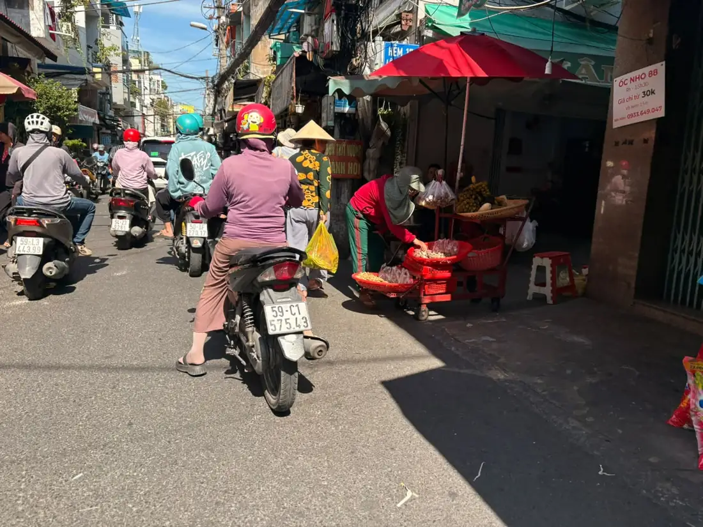

<strong>For your first 24 hours in Saigon, make arrival easy, choose one neighbourhood to explore and leave space to rest.</strong> Confirm your airport terminal, get to your hotel, arrange mobile data and some Vietnamese cash, then decide how much of the city you actually have energy for. An unhurried first day is usually more useful than a long checklist.

Saigon, officially Ho Chi Minh City, can feel loud, hot and wonderfully alive all at once. Traffic takes time, footpaths are uneven in places, and a coffee stop may become the best part of the afternoon. The practical details below are the ones we would talk through with a first-time guest.

<h2>First, get from Tan Son Nhat Airport to your hotel</h2>

<strong>Tan Son Nhat International Airport (SGN) has several passenger terminals.</strong> Terminal T2 serves international flights, while domestic flights can use T1 or T3 depending on the airline and service. Terminal assignments change, so check the <strong>operating airline's current flight information and your booking</strong> instead of guessing from the destination alone. The airport operator's <a class="text-link" href="https://acv.vn/en/tin-tuc/acv-s-activities/tan-son-nhat-international-airport-s-passenger-terminal-3-a-dynamic-and-modern-aviation-infrastructure" target="_blank" rel="noopener noreferrer">T3 announcement</a> explains the move of domestic flights and inter-terminal transport.

If someone is collecting you, send the flight number, scheduled landing time, passenger name and hotel address in advance. Confirm the exact terminal, <strong>meeting point after exiting the relevant arrivals area</strong> and how to contact the driver. A driver cannot be assumed to be standing immediately outside every exit. If you change terminals or flights, message the pickup provider once you have reliable information.

For independent travel, use a clearly identified official airport taxi counter, transport desk or reputable ride-hailing app. Check the vehicle and driver details in the app, confirm the hotel address and avoid accepting an unsolicited ride from someone approaching you. Immigration, baggage and traffic can all make arrival times unpredictable. Do not promise yourself a city activity immediately after landing.

For a straightforward transfer arranged in advance, you can see <a class="text-link" href="/transport/">OG Saigon's airport pickup and private transport options</a>. If you want guidance to an immigration priority lane, our separate <a class="text-link" href="/transport/#fast-track">Standard Airport Fast Track assistance</a> is available to enquire about, subject to confirmation.

<h2>What if your flight lands before hotel check-in?</h2>

An early landing is not the same as an available hotel room. Check your hotel's actual check-in policy before travelling. Ask whether it can store luggage and whether early check-in is possible; neither should be assumed. For an overnight flight, booking the preceding night may be worth discussing directly with the hotel if you need a room immediately.

Without a room yet, keep the plan gentle: breakfast, a shaded café and perhaps a short walk near your accommodation. You do not need a guided tour while carrying luggage or feeling exhausted.

<h2>Three first-day plans, depending on when you arrive</h2>
<h3>If you arrive in the morning</h3>

Transfer to the hotel, leave bags if permitted and get breakfast nearby. Rest during the hottest part of the day. Later, take a short walk around Nguyen Hue Walking Street and Dong Khoi in central Saigon, or visit the Central Post Office area if you still feel fresh. A simple dinner close to the hotel is enough.

<h3>If you arrive in the afternoon</h3>

Check in, shower and allow for traffic. Choose a small radius: the streets and cafés around your hotel, then an early evening meal. If you are staying around District 3, a relaxed coffee stop and a look at the Nhieu Loc Canal area may make more sense than travelling across town for a list of landmarks.

<h3>If you arrive late at night</h3>

Go directly to your hotel, confirm that reception expects your arrival, and keep food plans flexible. Check whether the hotel kitchen or nearby businesses are still serving rather than relying on published hours. Leave the city exploring for tomorrow. Saigon may stay lively late, but that does not mean every street or service is appropriate for a tired new arrival.

<h2>Traffic, walking and crossing the road</h2>

Motorbikes, turning vehicles and changing pavement conditions require attention. Use pedestrian crossings and traffic signals where available, but still watch for vehicles turning or ignoring them. Put your phone away before crossing. If a junction feels unsafe, wait, take a different crossing or use a short vehicle trip. There is no street-crossing trick that guarantees safety, and you should not blindly copy what another pedestrian does.

A place that looks close on a map can take longer than expected because of lights, congestion, heat, rain or the need to walk around a difficult junction. For a first day, plan one area at a time, with time for breaks rather than a tight minute-by-minute route.

<figure><figcaption>A lively Saigon street in daylight. Take your time and watch traffic around market stalls and junctions.</figcaption></figure>

<h2>Cash, cards, SIM cards and eSIMs</h2>

Cards work at many hotels, established restaurants and larger businesses. Carry some Vietnamese dong in small denominations for markets, small cafés and street-food stalls. Ask the price before ordering when it is not displayed, and check the currency and amount before approving a payment.

Working mobile data makes navigation, translation and contacting your driver much easier. Arrange roaming or a compatible eSIM before you fly, or use an established mobile provider's counter after arrival. Check that your phone supports eSIM if you choose that option. Public Wi-Fi can help, but do not depend on finding it at the exact moment you need your pickup instructions.

<h2>Heat, rain and finding a comfortable pace</h2>

Saigon's humidity can make a short walk feel longer than the distance suggests. Carry water, wear light clothing and plan shaded or indoor breaks. Rain can be sudden and heavy, especially during the wetter months. If there is flooding, lightning or poor visibility, change your route rather than pushing through.

Do not schedule a long countryside excursion on your arrival day just because there is an empty space in the calendar. Sleep, traffic and your comfort matter more than squeezing in another attraction.

<h2>Where should you explore without rushing?</h2>

<strong>Central District 1</strong> is practical for a first orientation: Dong Khoi, the Central Post Office area and Nguyen Hue are places you can combine without trying to cross the entire city. <strong>District 3</strong> is good for a quieter café and residential streets. <strong>District 4</strong>, just across the waterways from the centre, offers a different rhythm of markets, food stalls and older neighbourhood lanes.

If you are curious about local life rather than only landmarks, read <a class="text-link" href="/stories/district-4-saigon-history-culture/">our District 4 neighbourhood story</a>. If you want to eat around the backstreets with someone local, <a class="text-link" href="/experiences/hidden-saigon/">Hidden Saigon</a> is an option for a later evening when you feel rested.

<h2>Street food and small courtesies</h2>

Start with a dish that appeals to you, at a stall where ingredients and cooking are easy to see. If you have allergies or dietary restrictions, explain them clearly before ordering and do not assume every kitchen can avoid cross-contact. Cash and small notes are useful, but always check what payment a vendor accepts.

A friendly greeting and a little patience go a long way. Ask before photographing people, especially in residential alleys or at small family businesses. Sidewalks are shared working spaces, not simply tourist walkways; leave room for residents and vendors.

<h2>When is a local guide useful on day one?</h2>

A private airport pickup is useful when you want an agreed meeting point after a long journey. A local guide becomes more valuable when you have rested and want a conversation about the neighbourhoods, history or food rather than another rushed transfer between sights. Those are different needs, and you may only need one of them.

OG Saigon was founded by a fifth-generation Saigonese with roots in District 4. We prefer practical local context over a long list of must-sees. If you have two or three days and specific interests, <a class="text-link" href="/custom-trip/">build a day around what matters to you</a>, not around someone else's checklist.

Make arrival simple
<h2>Start with the essentials</h2>

<a class="text-link" href="/transport/">Arrange airport pickup or private transport →</a>
<a class="text-link" href="/custom-trip/">Plan a relaxed custom day in Saigon →</a>

