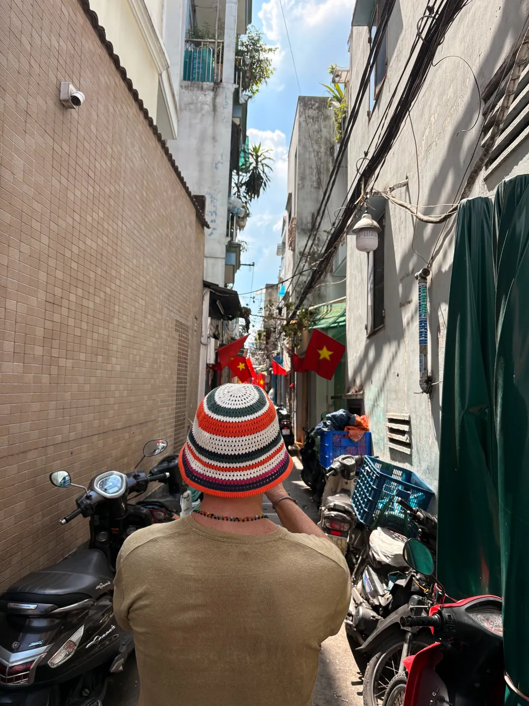
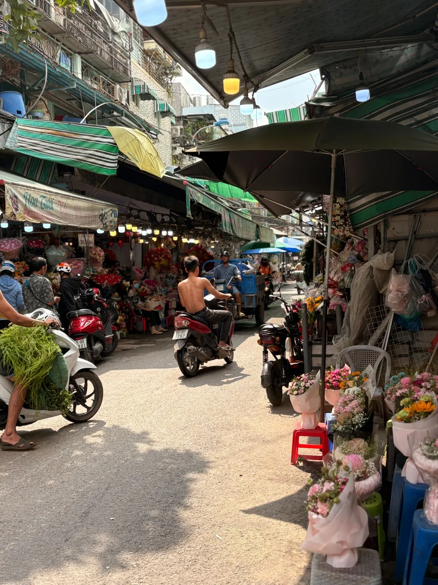
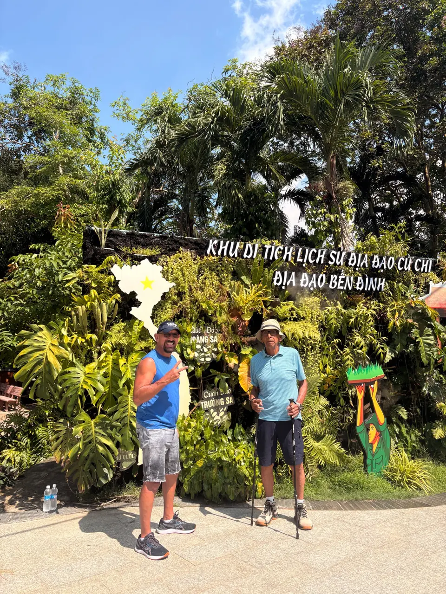
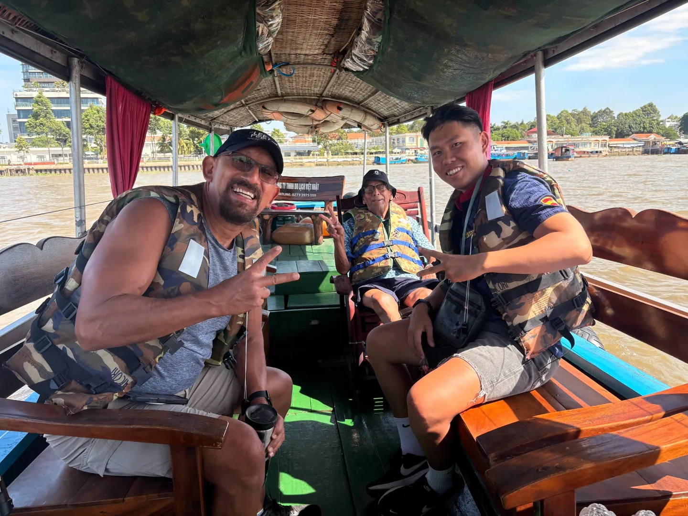
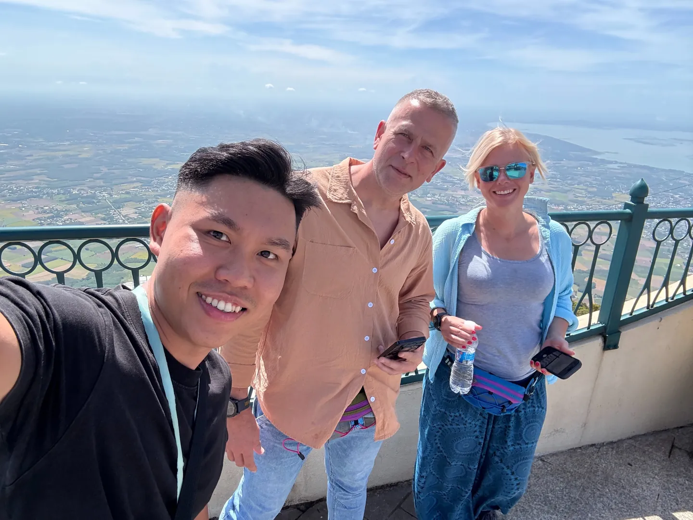
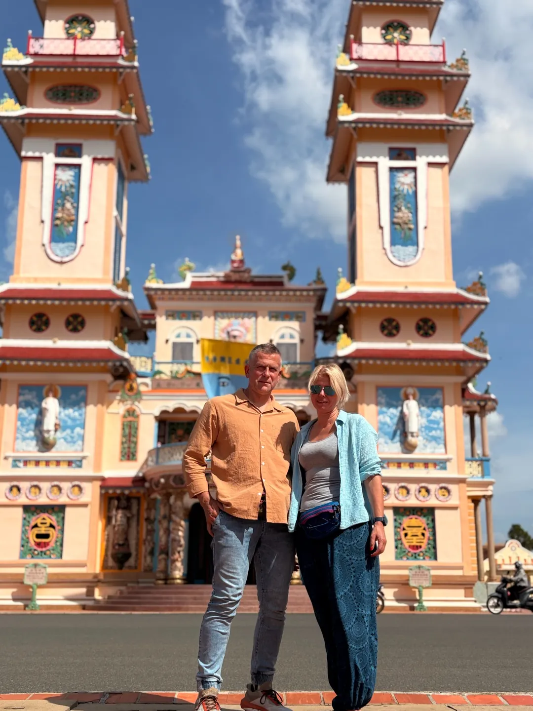
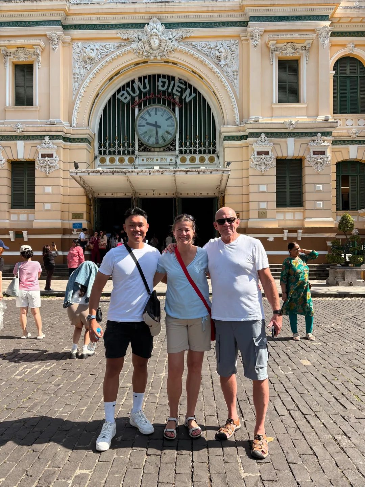

<small>Field notes from <a class="text-link" href="/meet-duy/">OG Saigon's local founder</a>, whose family has roots in District 4. These are real guest journeys, not fixed tour packages.</small>

Four groups of visitors. Four quite different ideas of what a good day should feel like.

One traveler wanted the lanes and apartment blocks you might never find on a typical sightseeing map. A father and son had three days to split between history, river life and food. One couple went beyond the city to Tây Ninh. Another came to know Saigon through its landmarks, local meals and the small practical questions that come up while traveling.

I grew up in District 4, and I still find that the most interesting part of guiding here is how differently people respond to the same city. These four journeys are a good reminder that a private trip is not simply a standard itinerary with a smaller group.

  
<strong>Planning a visit?</strong> A half day can be enough for a focused neighborhood walk. With two days, you can combine the city with one longer excursion. Three days give you more breathing room for history, food and the Mekong. The route should follow your interests, not the other way around.

## Four real journeys, four different ways of seeing Saigon

### 1. A Spanish traveler: the city between the landmarks

Our walking route ran for about five hours and covered roughly 10 kilometers on foot, with Grab rides connecting the longer stretches. We passed through the old Nguyễn Thiện Thuật apartment area, Hồ Thị Kỷ flower market and Hào Sĩ Phường. There was time for a neighborhood coffee, Vạn Phật Pagoda and the familiar textures of old District 4: markets, small lanes and streets that still feel lived in.

The famous central buildings were part of the wider journey, too. But what stayed with the route was everything between those landmarks: a corridor in an old apartment block, flower sellers at work and the way a narrow lane opens into another part of the city.

  <figure>
    
    <figcaption>Into the residential lanes that make Saigon feel personal.</figcaption>
  </figure>
  <figure>
    
    <figcaption>Flowers, deliveries and everyday market life at Hồ Thị Kỷ.</figcaption>
  </figure>

<strong>What can you see in Saigon in half a day?</strong> Quite a lot, if you choose a neighborhood or two. An old apartment area, a local market and a coffee stop can tell you more than rushing between six unrelated landmarks. Our five-hour route was a fairly active walk, not a pace everyone needs to copy.

### 2. An American dad and son: three days with room to explore

A father and son visiting from the United States explored southern Vietnam over three private days. First came the Củ Chi Tunnels and an evening motorbike food experience, with local stops in District 4 and food adjusted to their preferences. It was a day that moved from wartime history into the city after dark.

The following day was for the Mekong Delta: boats, canals, fruit, local food and the quieter rhythm of the river. On their third day, we returned to the city for places including the Independence Palace, War Remnants Museum, Central Post Office and Chợ Lớn. We also helped with their airport departure after the journey.

  <figure>
    
    <figcaption>Beginning with the history of Củ Chi.</figcaption>
  </figure>
  <figure>
    
    <figcaption>A different pace on the Mekong River.</figcaption>
  </figure>

<strong>How should you spend three days in Ho Chi Minh City?</strong> This journey offers one possible answer: a day for Củ Chi and evening food, a day in the Mekong Delta, and a day for Saigon's history and neighborhoods. It worked for this family; others may prefer to stay in the city longer.

### 3. A Polish couple: mountain air, Cao Đài and a local lunch

An early departure made sense for this full-day trip to Tây Ninh. Coffee and bánh mì were ready for the road, and there was a local coffee stop along the way. From there the day opened out onto Bà Đen Mountain, with its cable car and wide views across the landscape.

Later came the Cao Đài Holy See, with an entirely different atmosphere and architecture. Local food made the return journey feel like part of the experience rather than simply a drive home: bánh xèo, bánh khọt and a bowl of Trảng Bàng noodle soup.

  <figure>
    
    <figcaption>Above Tây Ninh, with space to take in the view.</figcaption>
  </figure>
  <figure>
    
    <figcaption>A stop at the remarkable Cao Đài Holy See.</figcaption>
  </figure>

<strong>What is a worthwhile day trip from Saigon?</strong> Tây Ninh suits travelers interested in mountain scenery, religious culture and regional food. Củ Chi is a different kind of history-focused outing, while the Mekong is about river landscapes and daily life. They are not interchangeable, so choose what genuinely interests you.

### 4. A lovely Polish couple: a city day that became more personal

For another couple from Poland, the starting point was a day in Saigon: the Central Post Office, major historical sites, lunch in District 4 and time in Chợ Lớn. We moved between monuments and neighborhoods rather than treating the whole day as a sequence of photo stops.

The conversation did not end with sightseeing. They also wanted local help with shopping and tailoring, including taking measurements and looking into fabric choices. A local fitting was one of the moments photographed later. Other ideas, including additional evening experiences and a water-bus outing, were discussed or arranged separately from the original city route. A good private plan has room to develop without pretending everything happened in a single day.

  <figure>
    
    <figcaption>A familiar landmark, seen together at the start of a city day.</figcaption>
  </figure>
  <figure>
    
    <figcaption>Getting measured at a local tailor, beyond the usual sightseeing stops.</figcaption>
  </figure>

<strong>Can you combine sightseeing, food, shopping and tailoring in Saigon?</strong> Yes, but think about the order. Measurements may need to happen before fabric shopping, and a tailor may need more time for later fittings. Ask about timing and costs directly instead of assuming clothes can be finished during a short visit.

## Ideas for one, two or three days in Saigon

These are <strong>suggested ways to organize your time</strong>, inspired by the journeys above. They are not claims that every combination below was completed by one group, and they are not fixed OG Saigon tour packages.

### What should you do with one day in Saigon?

Choose the city itself. Spend the morning around one or two historical sights, then give the afternoon to a neighborhood such as Chợ Lớn or the older residential streets closer to the center. Leave space for a proper lunch, coffee and an unplanned stop. If you enjoy food, an evening around District 4 can make a very different ending to the day.

For a more grounded look at local life, read our <a class="text-link" href="/stories/district-4-saigon-history-culture/">District 4 story</a> and <a class="text-link" href="/stories/cholon-saigon-chinatown/">Chợ Lớn field guide</a>.

### What can you do in Saigon in two days?

Use the first day for the city, with a mix of history, markets, food and quieter streets. For the second, make a choice instead of trying to fit in everything: visit Củ Chi for its wartime history, take a Mekong day trip for river life, or spend a full day in Tây Ninh.

If you want more time in Saigon's neighborhoods, there is no requirement to leave the city at all. Two thoughtful city days are better than an overloaded schedule. If you are considering Củ Chi, our guide to <a class="text-link" href="/stories/cu-chi-without-crawling/">visiting the tunnels without crawling</a> answers a common practical question.

### How can you plan three days in Ho Chi Minh City?

Three days can hold one city day, one historical excursion and one trip toward the Mekong, as the father-and-son journey shows. Alternatively, give yourself two days in Saigon and one day outside. The extra time can be used for food, art, shopping, family interests or simply a slower morning.

The important part is deciding which experiences deserve your energy, rather than fitting the maximum number of places onto a map.

### Is two days enough in Saigon, or should you take a day trip?

Two days are enough for a satisfying introduction, not for everything the city has to offer. If neighborhood life, museums, cafés and food are your main reasons for visiting, keep both days in Saigon. If the Mekong, Củ Chi or Tây Ninh is already high on your list, reserve a full day for that experience and accept that you will see less of the city itself.

## What happens between the landmarks matters

A city's famous buildings have stories worth hearing. So do its apartment corridors, neighborhood markets, small kitchens and the people carrying on with an ordinary day.

Growing up in old District 4 has shaped how I see those places. I do not think every visitor needs to walk 10 kilometers or eat exactly where I eat. But I do think it helps to have someone who knows when to keep moving and when to slow down. Sometimes that means a history stop. Sometimes it means taking Grab across town because the walk in between offers little. Sometimes it means making time for a fitting, a family meal or one more coffee.

The goal is not to avoid every tourist landmark. It is to give the famous and the everyday enough space to make sense together.

## Your trip does not need to look like theirs

Perhaps you have one day and want to spend it on foot. Perhaps you are traveling with family and need a gentler pace. Perhaps you are more interested in food or fabric shops than museums. All of those are reasonable ways to approach Saigon.

You do not need to arrive with a finished itinerary. Start with what you enjoy, how much time you have and a few places that caught your eye. A good route can grow from there.

